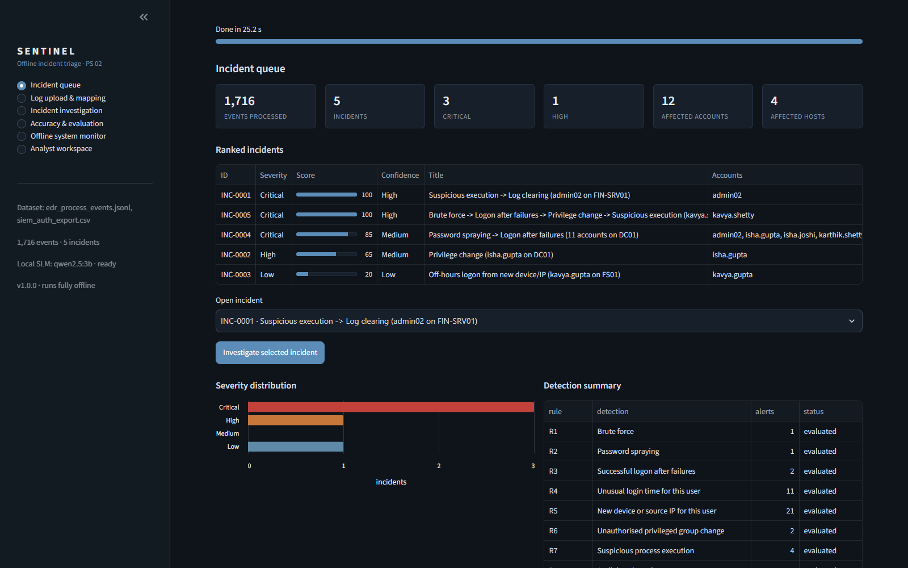
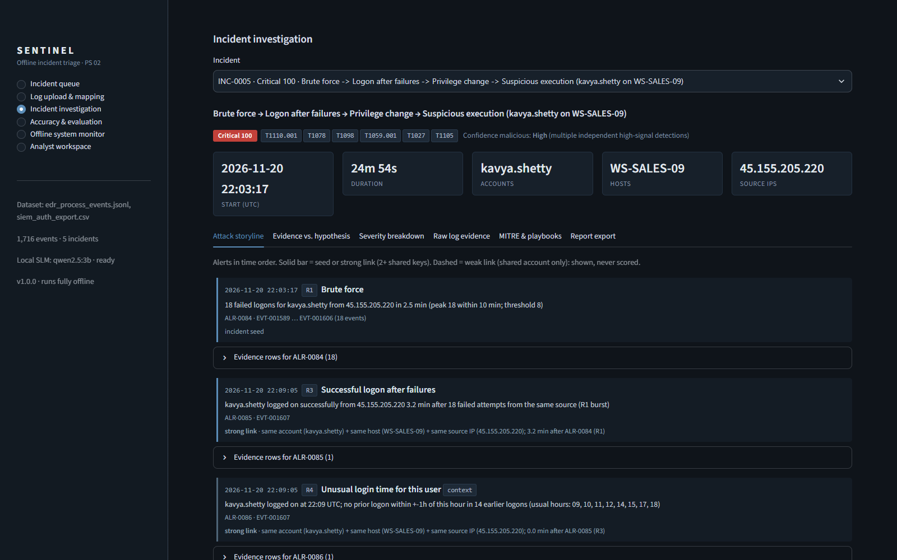
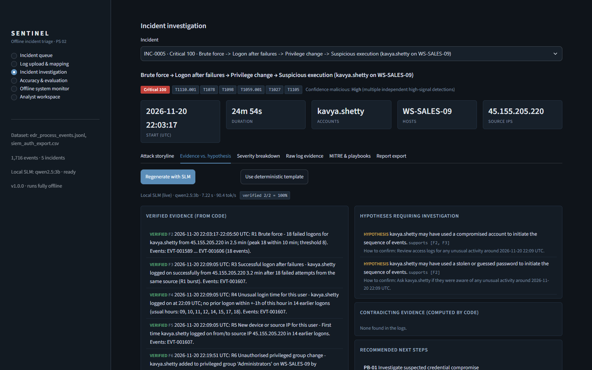
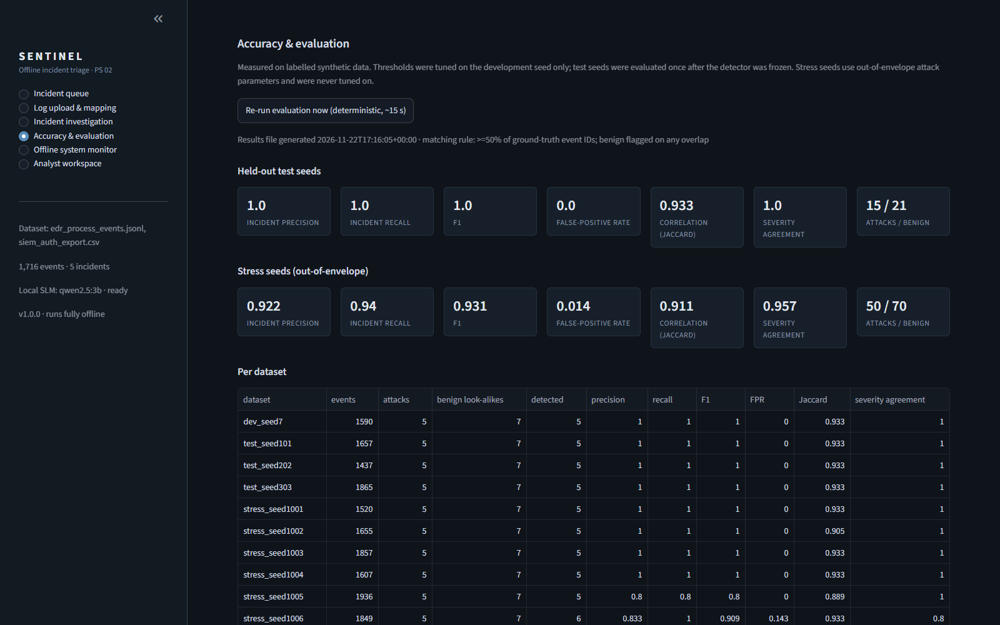
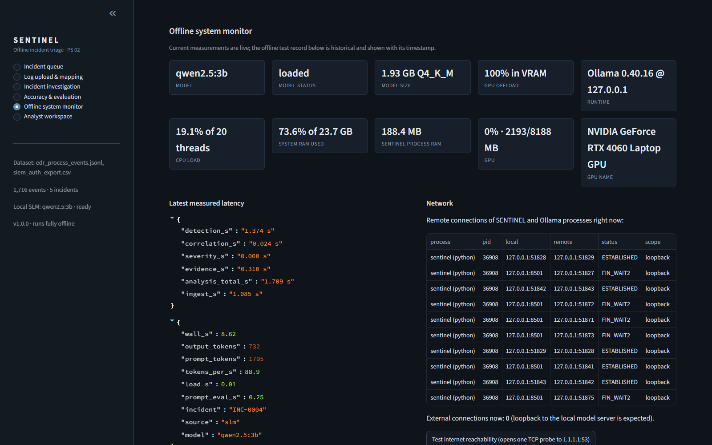

# SENTINEL: Offline Security Incident Triage Assistant

**Tinyverse Hackathon, Phase 2 · Problem Statement 02: Offline Security Incident Triage Assistant (Cybersecurity | Small Language Models)**

SENTINEL is an offline, evidence-verifiable incident investigator. It ingests authentication and endpoint logs (CSV / JSON), detects suspicious activity with deterministic rules and per-user baselines, reconstructs related alerts into **attack storylines**, and scores severity with a transparent 0–100 breakdown. A **locally running small language model** then explains each incident, and **every factual sentence it writes is checked against the logs** before it is shown as fact.

> Code produces the facts; the SLM interprets them. Detection, correlation, severity, verification and reporting never depend on the model.



---

## The problem (PS 02)

SOC analysts cannot read every authentication and endpoint log line, so incidents are missed. Organisations with limited connectivity or compute cannot send logs to cloud analytics. PS 02 asks for an **offline, SLM-powered** assistant that:
- processes auth and endpoint logs (CSV/JSON);
- detects at least 3 suspicious patterns;
- correlates events by user, device and time;
- classifies severity;
- integrates a local SLM meaningfully;
- produces evidence-backed reports with next steps;

all without internet.

## What makes SENTINEL different

| Differentiator | What it means |
|---|---|
| **Attack Storyline Engine** | Alerts become one chronological incident, and every link states *why* ("same account + same host, 1.4 min after R1 burst"). Weak single-attribute links are shown dashed and never raise severity. A shared host or IP alone never links alerts. |
| **Evidence Contract** | The SLM sees only numbered facts and must cite fact IDs. A verifier checks each sentence's citations, numbers, times, dates, accounts, hosts, IPs and event/alert IDs, plus content grounding and overclaiming. Failures are labelled **Unverified** and kept out of the summary. |
| **Evidence vs. hypothesis** | Verified evidence, supported conclusions, hypotheses (with supporting *and* contradicting facts), code-computed counter-evidence and recommended next steps are kept visibly apart. |
| **Measured, not claimed** | Incident-level precision, recall, F1 and FPR on held-out seeds, plus out-of-envelope stress seeds with their failures listed, a public-data sanity run, and a measured SLM verification rate. |
| **Verifiable offline operation** | A connection monitor logs every remote endpoint opened by SENTINEL and Ollama during a full run, including live inference, and records whether the machine could reach the internet. |

## Results (measured; see [docs/evaluation.md](docs/evaluation.md))

| Evaluation | Precision | Recall | F1 | FPR (benign look-alikes) | Correlation (Jaccard) | Severity agreement |
|---|---|---|---|---|---|---|
| Held-out test seeds (15 attacks, 21 look-alikes) | **1.000** | **1.000** | **1.000** | **0.000** | 0.933 | 1.000 |
| Stress seeds, out-of-envelope (50 attacks, 70 look-alikes) | 0.922 | 0.940 | 0.931 | 0.014 | 0.911 | 0.957 |

| Local SLM (qwen2.5:3b Q4_K_M, RTX 4060 Laptop, 100% in VRAM) | Value |
|---|---|
| Factual sentences that passed verification (15 test incidents) | **31 / 44 = 70%** in the saved run (70–80% across runs; unverified ones are labelled and removed from the summary) |
| Explanation latency per incident | ~6 s (6.0–6.6 s mean per seed) |
| Generation speed | ~90–93 tokens/s |
| Fallbacks needed | 0 / 15 |
| 7B comparison | 78% verified, but ~10.3 s, 48 tokens/s and 2.2× the VRAM, so 3B is kept |

| Deterministic pipeline (~1.9k events, quiet machine) | Value |
|---|---|
| Ingestion (CSV + JSON-lines) | ~0.15 s |
| Detection + correlation + severity + evidence packs | ~0.25 s |

**Honest caveat:** the labelled data comes from SENTINEL's own generator. Perfect test-seed scores show generalisation *within the designed attack styles*. The stress suite exists to show where the design breaks (slow brute force, small sprays, late successes), and those failures are listed rather than tuned away.

## Architecture

```
CSV / JSON / JSONL ─► ingest (mapper, UTC, rejects, dupes, SHA-256) ─► per-user baselines (4 h lag)
   ─► rules R1–R8 (+R9–R11, 4672 ctx) ─► Attack Storyline Engine ─► severity 0–100 + confidence
   ─► evidence pack (F1..Fn, supporting / contradicting) ─► local SLM (Ollama, JSON schema)
   ─► verifier (per sentence) ─► dashboard · HTML/PDF report · analyst workspace (SQLite audit)
                     └─ SLM unavailable / slow / invalid ─► deterministic template (100% verified)
```

Details: [docs/architecture.md](docs/architecture.md) · Traceability to PS 02: [docs/requirements_traceability.md](docs/requirements_traceability.md)

### Technology stack

Python 3.13 · Streamlit · pandas · scikit-learn (metrics) · PyYAML · Jinja2 · psutil · Ollama + **Qwen2.5-3B-Instruct (Q4_K_M)** · SQLite · pytest. There is no cloud service, graph database or JavaScript framework.

## Detection rules

| Rule | Detects | MITRE ATT&CK |
|---|---|---|
| R1 | Brute force: ≥ 8 failures for one account from one source within 10 min (sliding window) | T1110.001 |
| R2 | Password spraying: one source fails against ≥ 5 accounts, few attempts each | T1110.003 |
| R3 | Successful logon after a failure burst, same account and source, in the right order | T1078 |
| R4 | Unusual login time vs. the user's *own* history (context) | T1078 |
| R5 | New device or source IP for the user (context, low-confidence label when history is short) | T1078 |
| R6 | Privileged group add (4728/4732/4756) by a non-authorised actor or outside an approved change window | T1098 |
| R7 | Suspicious process: encoded PowerShell, download cradles, Mimikatz, LSASS dumps, certutil download, Office → shell, log clearing, shadow-copy deletion | T1059.001, T1003, T1105, T1070.001, … |
| R8 | Audit log cleared (1102), weighted when preceded by suspicious activity | T1070.001 |
| R9–R11 | Lateral movement to several new hosts (context), bulk copy/archive to removable or UNC paths, USB storage (6416, context) | T1021, T1039/T1074, T1052.001 |

Event 4672 is used as context only, never as proof of escalation. All thresholds, privileged groups, allowlists, change windows and process patterns are in [`config.yaml`](config.yaml), validated at load time.

## Installation

Requirements: Windows 10/11, Python 3.11–3.13, [Ollama](https://ollama.com), about 3 GB of disk for the model. A GPU is optional: the model runs on CPU too, more slowly.

```powershell
git clone https://github.com/dakshitha0705/SENTINEL.git
cd SENTINEL
powershell -ExecutionPolicy Bypass -File scripts\setup.ps1     # venv, pinned deps, sample data, model check
ollama pull qwen2.5:3b                                          # once, while online (~1.9 GB)
```

### Offline setup

1. While online:
   - run `setup.ps1` and `ollama pull qwen2.5:3b`;
   - optionally, `.\.venv\Scripts\python.exe -m pip download -r requirements.txt -d wheels` to keep wheels for an offline reinstall, which `setup.ps1` uses automatically;
   - optionally, run `python -I scripts\get_public_data.py` to fetch the public sanity-check logs.
2. Disconnect from the network. Everything below works offline.

## How to run

```powershell
.\scripts\run.ps1           # http://127.0.0.1:8501
.\scripts\run.ps1 -Demo     # opens directly on the unseen-format demo dataset
```

In the app:
1. **Log upload & mapping:** load a bundled sample or upload your own CSV/JSON files, check or correct the field mapping, then run the analysis.
2. **Incident queue:** incidents ranked by severity.
3. **Incident investigation:** storyline, evidence vs. hypothesis (local SLM), severity breakdown, raw log rows, MITRE and playbooks, HTML/PDF report.
4. **Accuracy & evaluation**, **Offline system monitor**, **Analyst workspace** (verified incident chat, dispositions, audit trail, reviewable suppressions).

## How to test

```powershell
.\scripts\test.ps1          # 57 pytest tests + held-out evaluation  (writes results/metrics.json)
.\scripts\test.ps1 -Slm     # also measures the SLM verification rate on the test seeds
.\.venv\Scripts\python.exe scripts\offline_check.py   # full workflow + connection log (run with Wi-Fi off)
```

The tests cover:
- ingestion (CSV, JSON, JSONL, timezones, missing fields, invalid records, duplicates, mapper);
- every rule and the benign look-alikes;
- baselines and insufficient history;
- correlation ordering, strong/weak links and incident separation;
- severity;
- evidence packs and the verifier (bad citations, wrong numbers, unsupported output);
- the report;
- SLM timeout, invalid output and unavailability fallbacks;
- offline guarantees;
- a headless render of every UI page.

## Datasets

- **Synthetic** (`data/generator.py`): 7 days, 23–29 accounts (regular, night-shift, admin, service), 21–24 hosts, normal schedules, 5 attack scenarios and 7 benign look-alike types. Labels live in separate `ground_truth.json` / `labels.csv` files that the detector never reads. Seeds:
  - **dev** 7 (the only tuning set);
  - **test** 101/202/303;
  - **stress** 1001–1010 (regenerated by `scripts/evaluate.py`);
  - **demo_unseen** 2024: a SIEM-style CSV with IST timestamps plus EDR JSON-lines, which needs two manual mapping corrections.
- **Public sanity check:** OTRF Security-Datasets (MIT), Mimikatz and comsvcs LSASS-dump recordings. SENTINEL flags the comsvcs LSASS dump (R7, Medium) and the log clear. The Mimikatz recording's activity is in PowerShell module logs (4103/800), which SENTINEL does not analyse; that is a stated limitation. See `results/public_sanity.json`.

## Evidence Contract (summary)

1. The evidence pack contains facts F1..Fn: detections with event IDs, counts and times; links; the severity breakdown; supporting and contradicting evidence.
2. The SLM returns schema-constrained JSON (`summary`, `supported_conclusions`, `hypotheses`, `recommended_actions`, `open_questions`), citing fact IDs.
3. The verifier checks every sentence. Only **Verified** sentences reach the executive summary; playbooks outside the incident's offline library are rejected.
4. If the SLM times out, is unreachable or returns invalid output, a deterministic template explanation is used, verified at 100%.

## Limitations

- **Synthetic accuracy.** Accuracy is measured on synthetic data built by the same author; real-world accuracy is unknown. Stress seeds show misses for slow brute force (below R1 density), small sprays (< 5 accounts) and successes later than 15 minutes.
- **Lexical verification.** The verifier checks facts lexically: it catches wrong numbers, names, times and citations, but not every subtly unsupported qualifier.
- **Missing log sources.** PowerShell script-block/module logs (4103/4104/800), Kerberos (4768/4769) and network flows are not analysed.
- **Thin coverage for R10/R11.** These rules are unit-tested only; the synthetic data contains no such events.
- **Timezone assumption.** Timestamps without a timezone are treated as UTC.
- **Logs can't prove authorisation.** SENTINEL reports what the logs show, not who was at the keyboard.

## Screenshots

| | |
|---|---|
|  |  |
|  |  |

## Demo

Five-minute offline demo script and prepared answers: [docs/demo_script.md](docs/demo_script.md). Offline validation record: [docs/offline_validation.md](docs/offline_validation.md).

## Credits and AI assistance

See [docs/credits.md](docs/credits.md). In short:
- Built for the Tinyverse Hackathon PS 02 by the participant, with **Claude Code (Anthropic) as an AI coding assistant**; commits it authored carry a co-author trailer.
- Runtime model: Qwen2.5-3B-Instruct (Qwen Research License) via Ollama (MIT).
- Public logs: OTRF Security-Datasets (MIT).
- Technique data: MITRE ATT&CK®.
- Libraries: Streamlit, pandas, NumPy, scikit-learn, PyYAML, Jinja2, psutil, Altair, pytest, python-pptx, Playwright (screenshots only).

## Licence

Source code: MIT (see [LICENSE](LICENSE)). Third-party components keep their own licences, listed in `docs/credits.md`.
