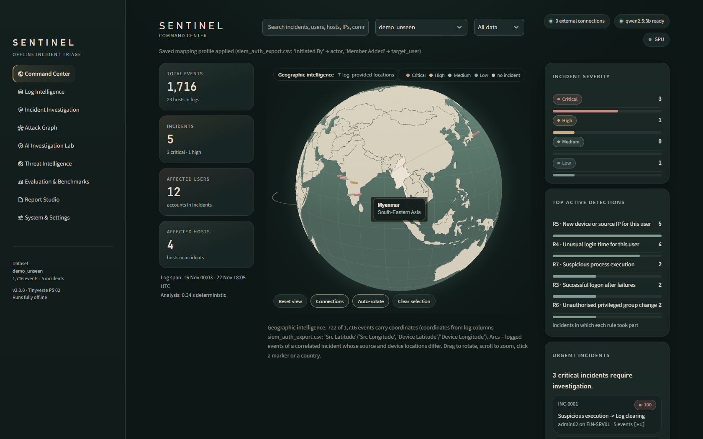

# SENTINEL: Offline Security Incident Triage Assistant

**Tinyverse Hackathon, Phase 2 · Problem Statement 02: Offline Security Incident Triage Assistant (Cybersecurity | Small Language Models)**

SENTINEL is an offline, evidence-verifiable incident investigator. It:
- ingests authentication and endpoint logs (CSV, JSON, JSON-lines and Windows EVTX);
- detects suspicious activity with deterministic rules and per-user baselines;
- reconstructs related alerts into **attack storylines**;
- scores severity with a transparent 0–100 breakdown.

A **locally running small language model** (Qwen2.5-3B via Ollama) then explains each incident. **Every factual claim it makes is checked against the logs** before it is shown as fact.

> Code produces the facts; the local model interprets them; the verifier checks every factual claim. Detection, correlation, severity, verification and reporting never depend on the model.



---

## What PS 02 asks for, and where it is

| PS 02 requirement | SENTINEL |
|---|---|
| Process auth and endpoint logs (CSV/JSON) | CSV, JSON, JSON-lines and **EVTX** (offline converter); column mapper with warnings and saved profiles |
| Detect ≥ 3 suspicious patterns | **14 rules** (R1–R14); per-user baselines; allowlists and change windows |
| Correlate by user, device, time | Attack Storyline Engine: every link states *why*; a shared host or IP alone never links |
| Classify severity | 0–100 score, line-by-line breakdown, separate confidence |
| Meaningful local SLM | Typed explanations, hypotheses with supporting *and* contradicting facts, one bounded self-repair round, verified chat, handoff notes |
| Evidence-backed reports with next steps | HTML/PDF/JSON/CSV with only verified statements, original log rows, MITRE, playbooks, file hashes |
| Works offline | Recorded disconnected runs; browser check with every non-local request blocked: 0 requested |

## Results (measured; see [docs/evaluation.md](docs/evaluation.md))

| Detection (synthetic, generator ground truth) | Precision | Recall | F1 | FPR (look-alikes) | Jaccard | Severity agreement |
|---|---|---|---|---|---|---|
| **Fresh held-out seeds 5001–5010** (generated after the upgrade freeze; 50 attacks, 100 look-alikes) | **0.942** | **0.980** | **0.961** | **0.030** | 0.971 | 0.898 |
| Test seeds 101/202/303 (15 attacks, 21 look-alikes) | 1.000 | 1.000 | 1.000 | 0.000 | 1.000 | 1.000 |
| Same fresh seeds, **v1 detector** (before the upgrade) | 0.825 | 0.940 | 0.879 | 0.030 | 0.883 | 0.809 |

| Workload and design (held-out test + fresh) | Value |
|---|---|
| Alert compression | 571 alerts → 67 incidents (**88.3%** fewer items) |
| Naive detector (no baselines, allowlists, context or correlation) | 1,651 items, strict F1 0.058; finds every attack only under lenient matching |
| Ablation F1 (strict): full / no baselines / no allowlists / no context | 0.970 / 0.797 / 0.889 / 0.341 |

| Real attack recordings (EVTX-ATTACK-SAMPLES, OTRF) | Value |
|---|---|
| Recordings with an expected behaviour | 14: **8 detected**, 6 missed (all 6 in telemetry SENTINEL does not analyse; listed) |
| Control recording | no alert |

| Local SLM (qwen2.5:3b Q4_K_M) | Value |
|---|---|
| Factual claims verified, first attempt → after one self-repair round | **73% → 83%** (15 held-out incidents; another run gave 77% → 87%) |
| Latency per incident, GPU (RTX 4060 Laptop, 100% in VRAM) | about 6 s (8 s incl. repairs), about 93 tokens/s |
| Latency per incident, **CPU only** (num_gpu = 0, 0 bytes in VRAM) | about 46 s, about 16 tokens/s |
| Incident chat | 35 questions, **0 silent replies**, 53/54 sentences verified |

| Deterministic pipeline | Value |
|---|---|
| **126,919 events** end to end (ingest → evidence packs) | **17.5 s** (7,272 events/s), peak RAM 529 MB |
| Typical dataset (about 1.7k events) | about 0.25–0.35 s |

**Honest caveats.**
- The labelled data comes from SENTINEL's own generator. The fresh seeds and the stress diagnostics show where the design breaks, and those failures are listed rather than tuned away.
- The external recordings carry only technique labels, so they measure scenario detection, not precision.
- The verifier is lexical and structural, not semantic.

## The dashboard (nine pages)

| Page | What it does |
|---|---|
| **Command Center** | KPIs, the **interactive 3D globe** (drag, zoom, reset, click markers or countries), severity, top detections, urgent incidents, the four main actions |
| **Log Intelligence** | Upload CSV/JSON/JSONL/EVTX, EVTX conversion diagnostics, column mapping, validation, event explorer, rejected/duplicate records, SHA-256, exports |
| **Incident Investigation** | Filterable queue; storyline, evidence, severity, MITRE and playbooks; status, disposition, notes, audit trail; exports |
| **Attack Graph** | Interactive graph of incidents, detections, accounts, hosts and IPs. Every edge comes from the correlation engine |
| **AI Investigation Lab** | Local Qwen explanation with typed-claim verification and the self-repair outcome; verified chat; analyst handoff note |
| **Threat Intelligence** | Threat hunting (prepared hunts and regex, pivots), MITRE ATT&CK explorer, the rule catalogue |
| **Evaluation & Benchmarks** | Every number above, read from `results/*.json`; buttons to re-run the deterministic evaluations |
| **Report Studio** | Report preview, HTML/PDF, JSON/CSV/ZIP bulk export |
| **System & Settings** | Offline monitor, model selector, CPU-only mode, self-repair toggle, validated detection settings, suppressions, audit, offline-run history, credits |

**About the globe.** It only plots coordinates that the logs themselves contain (for example a SIEM export's source and device geo columns). SENTINEL never guesses a location from an IP and calls no geolocation service. Without location columns the globe stays in **exploration mode** and says so. The bundled demo export carries *synthetic* geo columns; its external addresses are RFC 5737 documentation ranges.

Every visible control and its backend, data source and test are listed in [docs/feature_traceability.md](docs/feature_traceability.md).

## Architecture

```
CSV / JSON / JSONL / EVTX ─► ingest (mapper, UTC, rejects, dupes, SHA-256) ─► per-user baselines (4 h lag)
   ─► rules R1–R14 ─► Attack Storyline Engine ─► severity 0–100 + confidence ─► evidence pack F1..Fn
   ─► local Qwen (Ollama, typed JSON) ─► verifier ─► one self-repair round ─► verifier
   ─► dashboard · HTML/PDF/JSON/CSV · handoff notes · analyst workspace (SQLite audit)
        └─ model unavailable / slow / invalid ─► deterministic template or answer (verified)
```

Details: [docs/architecture.md](docs/architecture.md) · PS 02 traceability: [docs/requirements_traceability.md](docs/requirements_traceability.md)

**Stack.** Python 3.13 · Streamlit · pandas · scikit-learn (metrics) · PyYAML · Jinja2 · psutil · evtx · Ollama + **Qwen2.5-3B-Instruct (Q4_K_M)** · SQLite · pytest.
Front-end assets are bundled locally: globe.gl / three.js, vis-network, Natural Earth outlines. There is no cloud service and no CDN.

## Detection rules

| Rule | Detects | MITRE |
|---|---|---|
| R1 | Brute force: ≥ 8 failures for one account from one source within 10 min | T1110.001 |
| R2 | Password spraying: one source fails against ≥ 5 accounts, few attempts each | T1110.003 |
| R3 | Success after a failure burst, same account and source, up to 60 min later. Full weight to 15 min, then decaying; never treated as proof of compromise | T1078 |
| R4 / R5 | Unusual logon hour / new device or IP vs. the user's *own* history (context; confidence-labelled) | T1078 |
| R6 | Privileged group add by a non-authorised actor or outside an approved change window | T1098 |
| R7 | Suspicious process: encoded PowerShell, download cradles, Mimikatz, LSASS dumps, certutil, Office → shell, log clearing, shadow-copy deletion | T1059.001, T1003, T1105, … |
| R8 | Audit log cleared (1102, System 104); weighted when preceded by suspicious activity | T1070.001 |
| R9–R11 | Lateral movement (context), bulk copy/archive staging, USB storage (context) | T1021, T1039/T1074, T1052.001 |
| **R12** | Sustained brute force: ≥ 8 in 60 min or ≥ 20 in 24 h, from a source never used by the account | T1110.001 |
| **R13** | Small password spray: ≥ 3 accounts, ≥ 80% failures, sources unknown to the targets | T1110.003 |
| **R14** | Privileged group discovery (`net group "Domain Admins"`, 4799, …), context only | T1069 |

Thresholds, groups, allowlists, change windows and process patterns live in [`config.yaml`](config.yaml) and are validated at load. The dashboard can override them per session, or persist the overrides to `workspace/settings.yaml`; reported metrics always use `config.yaml`.

## Installation

Requirements: Windows 10/11, Python 3.11–3.13, [Ollama](https://ollama.com), about 3 GB of disk for the model. A GPU is optional (CPU-only is measured above).

```powershell
git clone https://github.com/dakshitha0705/SENTINEL.git
cd SENTINEL
powershell -ExecutionPolicy Bypass -File scripts\setup.ps1     # venv, pinned deps, sample data, model check
ollama pull qwen2.5:3b                                          # once, while online (~1.9 GB)
```

**Offline setup.** While online:
1. Run `setup.ps1` and `ollama pull qwen2.5:3b`.
2. Optionally keep wheels for an offline reinstall: `python -m pip download -r requirements.txt -d wheels`.
3. Optionally fetch the public attack recordings: `python -I scripts\get_external_data.py`.

Then disconnect; everything works offline.

## How to run

```powershell
.\scripts\run.ps1           # http://127.0.0.1:8501 (opens the bundled demo dataset)
```

## How to test

```powershell
.\.venv\Scripts\python.exe -m pytest -q                       # 90 tests
.\.venv\Scripts\python.exe scripts\evaluate.py                # synthetic accuracy, comparison, ablation
.\.venv\Scripts\python.exe scripts\external_eval.py           # public attack recordings (after download)
.\.venv\Scripts\python.exe scripts\slm_benchmark.py [--cpu]   # local model, verification, self-repair
.\.venv\Scripts\python.exe scripts\scale_benchmark.py         # 126,919 events
.\.venv\Scripts\python.exe scripts\offline_check.py           # full workflow + connection log (Wi-Fi off)
.\.venv\Scripts\python.exe scripts\ui_check.py                # browser check, external requests blocked
```

## Limitations

- **Synthetic labelled data.** Accuracy is measured on data from SENTINEL's own generator. Real-world accuracy is unknown; the external recordings give scenario-level evidence only.
- **Known misses.** S5 when the victim's baseline is not yet confident; five failures in 11 minutes from a new source (indistinguishable from a forgotten password); approved admin work from a new host can still produce a Low incident.
- **Telemetry not analysed:** PowerShell script-block and module logs (4103/4104/800), Sysmon process access (10), object access (4661), network flows, and 4688 events without command lines.
- **Lexical and structural verification.** It catches wrong numbers, names, times, IDs and typed values, but not every subtly unsupported qualifier.
- **Globe.** Only log-provided coordinates are shown. There is no IP geolocation database (by design).
- **Small models.** qwen2.5:1.5b is faster but verified only 16–32% of its claims, so it is not the default.
- **Other.** R10/R11 are unit-tested only. Timestamps without a timezone are treated as UTC.

## Documentation

| Document | Contents |
|---|---|
| [evaluation.md](docs/evaluation.md) | All measurements and protocols |
| [feature_traceability.md](docs/feature_traceability.md) | Frontend → backend → data → test for every feature |
| [architecture.md](docs/architecture.md) | Modules, schema, rules, linking, severity, Evidence Contract |
| [offline_validation.md](docs/offline_validation.md) | Recorded online rehearsals and disconnected runs |
| [demo_script.md](docs/demo_script.md) | Five-minute offline demo with answers to likely questions |
| [requirements_traceability.md](docs/requirements_traceability.md) | PS 02 requirements → implementation → tests; recorded conflicts |
| [credits.md](docs/credits.md) | Third-party components, datasets, model licences, AI assistance |

## Credits and AI assistance

Built for the Tinyverse Hackathon PS 02 by the participant, with **Claude Code (Anthropic) as an AI coding assistant**; commits it authored carry a co-author trailer.

Third-party components:
- **Model:** Qwen2.5 via Ollama.
- **Front end:** globe.gl / three.js, vis-network, Natural Earth.
- **Data:** EVTX-ATTACK-SAMPLES (GPL-3.0, not redistributed) and OTRF Security-Datasets (MIT).
- **Reference:** MITRE ATT&CK®.

Details: [docs/credits.md](docs/credits.md).

## Licence

Source code: MIT (see [LICENSE](LICENSE)). Third-party components keep their own licences.
